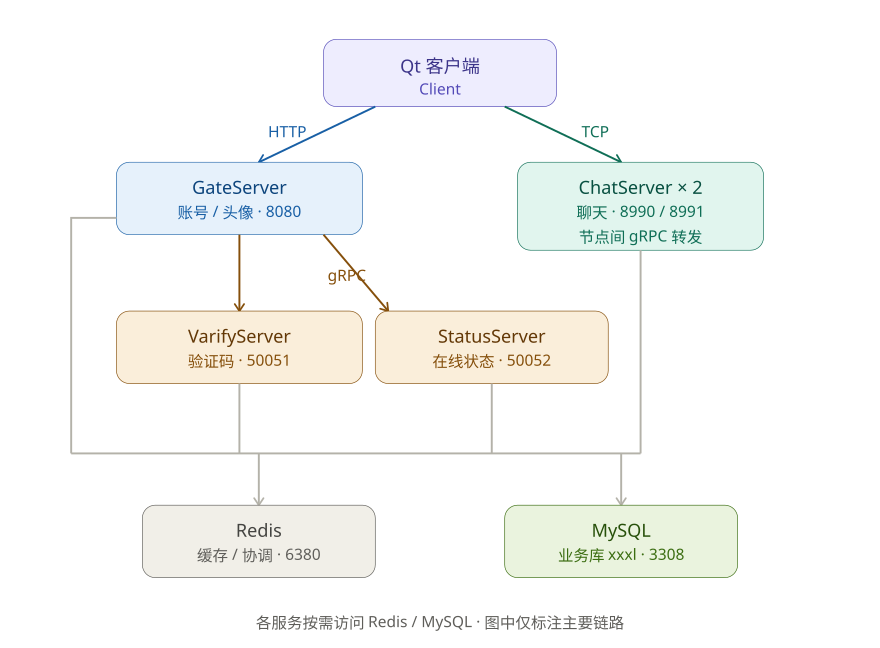

<div align="center">

# 💬 Hcat

**分布式即时通讯系统 · C++ 后端学习项目**
采用 Qt 客户端 + 多 C++/Node 微服务的分布式架构的即时通讯系统。

[]()
[]()
[]()
[]()
[]()
[]()
[]()
[]()

[功能特性](#-功能特性) · [系统架构](#-系统架构) · [快速开始](#-快速开始) · [构建](#-构建指南) · [测试](#-测试) · [FAQ](#-常见问题)

<!-- 放一张运行截图（对话/好友界面） -->

</div>

---

## ✨ 功能特性

- 🔐 **账号体系** — 注册 / 登录 / 重置密码，邮箱验证码校验
- 👥 **好友社交** — 搜索用户、好友申请、好友列表、资料卡
- 💬 **实时聊天** — 单聊文本 / 图片，历史消息分页拉取，未读状态
- 🖼️ **头像管理** — 上传头像、异步加载、磁盘 + 内存双层缓存
- 🟢 **在线状态** — StatusServer 统一维护，心跳保活
- 🌐 **分布式聊天** — 双 ChatServer 共享 Redis，跨节点消息 gRPC 转发

---

<div align="center">

## 🏗️ 系统架构



</div>

**数据流要点**

1. 客户端两条独立链路：**HTTP → GateServer**（账号/头像）与 **TCP → ChatServer**（聊天），互不影响。
2. 登录：HTTP 取账号 → 用 token 建 TCP 连接登录 ChatServer，登录回包携带好友列表。
3. 双 ChatServer 共享 Redis：验证码、token、在线状态、分布式协调。
4. 跨节点：用户分属两台 ChatServer 时，消息经节点间 gRPC（50055/50056）转发。

---

## 🧰 技术栈

| 层 | 技术 |
|----|------|
| 客户端 | Qt 6.5.3 (MinGW 64-bit)，QWidget + 自定义气泡控件 |
| HTTP 网关 | Boost.Beast / Boost.Asio |
| 聊天服务 | Boost.Asio，自定义 2 字节 id + 2 字节长度大端帧协议 |
| RPC | gRPC + Protobuf (vcpkg) |
| 缓存 / 协调 | Redis（redis++ / hiredis） |
| 存储 | MySQL 8.0（MySQL Connector/C++ 26.7.0） |
| 验证码 | Node.js（@grpc/grpc-js + nodemailer） |
| JSON | jsoncpp |
| 构建 | VS2022 (MSVC) + vcpkg + Qt Creator |

---

## 📁 目录结构

```
Hcat/
├── Client/            # Qt 6.5.3 客户端（Hcat.pro）
├── GateServer/        # HTTP 网关（Boost.Beast，:8080）
├── StatusServer/      # 在线状态服务（gRPC，:50052）
├── ChatServer/        # 聊天节点 1（TCP :8990，RPC :50055）
├── ChatServer2/       # 聊天节点 2（TCP :8991，RPC :50056）
├── VarifyServer/      # 验证码服务（Node.js gRPC，:50051）
├── Start/             # 一键启停脚本
├── test/              # 协议 / 接口 / 安全测试
└── sql/               # 数据库种子数据
```

---

## 🔌 服务与端口

| 服务 | 类型 | 端口 | 说明 |
|------|------|------|------|
| GateServer | HTTP | `8080` | 登录 / 注册 / 重置 / 上传 / 头像下载 |
| StatusServer | gRPC | `50052` | 在线状态、心跳 |
| ChatServer 1 | TCP / RPC | `8990` / `50055` | 聊天主节点 |
| ChatServer 2 | TCP / RPC | `8991` / `50056` | 聊天从节点 |
| VarifyServer | gRPC | `50051` | Node.js 邮件验证码 |
| MySQL | — | `3308` | 业务库 `Hcat` |
| Redis | — | `6380` | 验证码 / token / 在线状态 |

> 端口集中在各服务的 `config.ini`；改动时需同步 `Start/*.bat`、`test/run_test.bat`。

---

## 📦 环境依赖

| 软件 | 版本 | 用途 |
|------|------|------|
| Visual Studio 2022 | MSVC 14.4x | C++ 后端 |
| vcpkg | x64-windows | grpc / protobuf / redis++ / hiredis / boost / jsoncpp |
| Qt | 6.5.3 MinGW 64-bit | 客户端 |
| MySQL Connector/C++ | 26.7.0 | MySQL 驱动 |
| MySQL | 8.0 | 存储 |
| Redis | — | 缓存 |
| Node.js | — | 验证码服务 |

---

## 🔨 构建指南

### 后端（GateServer / StatusServer / ChatServer×2）

```bash
# 1. 确认 vcpkg 已安装依赖（triplet x64-windows）
vcpkg install grpc protobuf redis-plus-plus hiredis boost jsoncpp

# 2. 用 VS2022 打开对应 .sln，选择 Release | x64 生成
```

> **⚠️ 后端务必用 Release 运行**：MySQL Connector/C++ 只提供 Release DLL（/MD），默认 Debug(/MDd) 会因 STL 布局不一致导致跨 DLL 传 `sql::SQLString` 时内存错乱崩溃。本项目已把 Debug 改造成「Release 运行时 + 无优化」，两个配置都可断点调试。

### 客户端（Client）

```text
1. Qt Creator 打开 Client/Hcat.pro（Kit: Qt 6.5.3 MinGW 64-bit）
2. 构建目录 Client/build/Desktop_Qt_6_5_3_MinGW_64_bit-Debug
3. bin/Hcat.exe 同级会自动拷贝所需 DLL 与 config.ini
```

> **⚠️ 用 Qt Creator 构建，不要在 Git Bash 里跑 qmake/make**：`.pro` 的 post-link 是 cmd 语法，sh 会把 `/Y` 当 POSIX 路径转换导致失败。

---

## 🚀 快速开始

```bash
# 0. 启动 MySQL(3308) 与 Redis(6380)，建好 Hcat 库，可执行 sql/seed_debug_data.sql 造测试数据

# 1. 一键启动全部（后端 + 客户端）
Start\start.bat

# 常用变体
Start\start.bat backend   # 只启动后端
Start\start.bat chat2     # 聊天节点换成 ChatServer2
Start\start.bat client    # 只启动客户端

# 2. 一键停止
Start\stop.bat
```

手动启动见下表（用于调试）：

| 服务 | 工作目录 | 命令 |
|------|----------|------|
| VarifyServer | `VarifyServer/` | `node server.js` |
| GateServer | `GateServer/` | `x64\Release\GateServer.exe` |
| StatusServer | `StatusServer/` | `x64\Release\StatusServer.exe` |
| ChatServer 1 | `ChatServer/` | `x64\Release\ChatServer.exe` |
| ChatServer 2 | `ChatServer2/` | `x64\Release\ChatServer.exe` |
| 客户端 | `Client/.../bin` | `Hcat.exe` |

> GateServer 工作目录必须是 `GateServer/`（从 cwd 读 `config.ini`），且 exe 同级需有 `plugin/`（MySQL 认证插件）。

---

## 🧪 测试

```bash
test\run_test.bat        # 一键协议测试（自动拉起 ChatServer，跑 protocol_test.py）
```

| 脚本 | 作用 |
|------|------|
| `protocol_test.py` | ChatServer 协议用例（登录/拉会话/发消息/越界） |
| `gate_api_test.py` | GateServer HTTP 接口 |
| `gate_e2e_test.py` | Gate 端到端 |
| `login_load_test.py` | 登录压测 |
| `security_fuzz_test.py` | 安全 / 模糊测试 |

退出码：`0` 全部通过 · `1` 协议异常 · `2` 依赖缺失 · `3` ChatServer 被打崩。

---

## 🗄️ 数据库

库 `Hcat` 核心表：

| 表 | 用途 |
|----|------|
| `user` | 用户（id, uid, name, email, pwd, nick, icon） |
| `user_id` | uid 自增主键 |
| `friend` | 好友关系（双向） |
| `friend_apply` | 好友申请 |
| `chat_thread` | 会话 |
| `private_chat` | 私聊映射 |
| `chat_message` | 聊天消息 |

---

## ❓ 常见问题

<details>
<summary><b>后端启动即崩溃 / 连不上 MySQL</b></summary>

确认两点：① 用 **Release** 配置运行；② 工作目录在服务目录下且 exe 同级有 `plugin/`。报 `Authentication plugin 'mysql_native_password' cannot be loaded` 即为缺 `plugin/`。
</details>

<details>
<summary><b>客户端头像空白</b></summary>

`icon` 有两种存法（`upload/xxx.png` 服务端路径 / `head_x.jpg` 本地路径），统一走 `ImageManager::loadAvatar`，它会自动区分并在失败时回退默认头像。
</details>

<details>
<summary><b>Git Bash 里构建客户端失败</b></summary>

`.pro` 的 post-link 是 cmd 语法（`copy /Y` + `xcopy`），必须改用 Qt Creator 构建；不要删除 `.qmake.stash` / `Makefile`。
</details>

<details>
<summary><b>增量构建跳过 / undefined reference</b></summary>

复制教程文件会保留旧时间戳导致 make 判定无需重编。`touch *.cpp *.h *.ui *.qrc` 后全量重编。
</details>

---

## 📜 License

学习项目，基于 llfcchat 教程实现。仅供学习交流。

<div align="center">
<sub>Built with ❤️ as a C++ backend learning project</sub>

</div>
