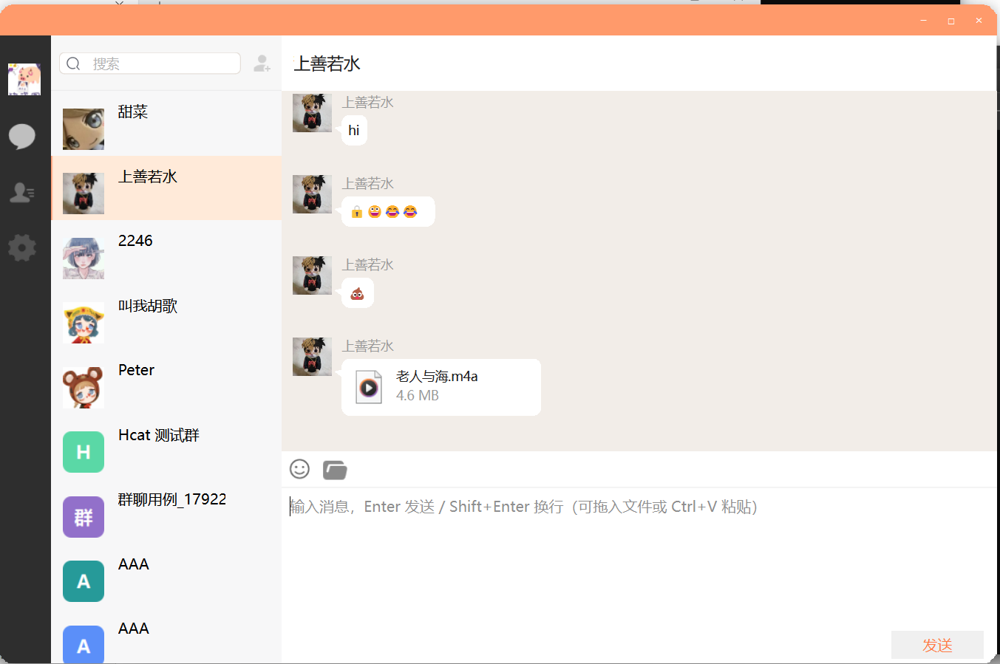

<div align="center">

# 💬 Hcat

**分布式即时通讯系统 · C++ 后端学习项目**
Qt 6 客户端 + 多 C++/Node 微服务，一套代码同时跑在 Windows 开发机与阿里云 Ubuntu 服务器上。

[]()
[]()
[]()
[]()
[]()
[]()
[]()
[]()

[功能特性](#-功能特性) · [系统架构](#-系统架构) · [快速开始](#-快速开始) · [构建](#-构建指南) · [测试](#-测试) · [文档](#-文档导航) · [FAQ](#-常见问题)

<!-- 运行截图待补：screenshot/ 下现有两张是 10-24 改版前的旧 UI（橙色主题），
     与当前静靛设计不符，先不嵌入。补图时替换下面这行即可（建议 1280x800 以上）：
      -->

</div>

---

## ✨ 功能特性

**通讯**
- 🔐 **账号体系** — 注册 / 登录 / 重置密码，邮箱验证码校验（Node 服务发信）
- 👥 **好友社交** — 用户搜索、好友申请与审批、好友列表、资料卡、备注名
- 💬 **实时聊天** — 单聊与群聊，文本 / 图片 / 文件消息混合发送，历史消息分页拉取、未读标记
- 😊 **表情面板** — Unicode emoji 一键插入，复用文本消息链路，跨端收发零后端改动
- 🖼️ **图片消息** — 缩放预览 + 点击灯箱大图，异步下载 + 磁盘/内存双层缓存
- 📎 **文件消息** — 流式直传（非 base64），单文件上限 300MB，带进度条与文件气泡下载
- 👨‍👩‍👧 **群聊** — 右键发起群聊 / 查看群成员 / 邀请好友入群，成员变更实时通知
- 🟢 **在线状态** — StatusServer 统一维护，心跳保活；客户端头像角标实时反映连接状态

**架构与工程**
- 🌐 **分布式聊天** — 双 ChatServer 共享 Redis，跨节点消息经 gRPC 转发
- 🧱 **共享源码双实例** — ChatServer2 通过 `SharedSources.props` 引用 ChatServer 源码，**差异只在 `config.ini`**
- 🎨 **设计系统** — 无边框自绘标题栏、单 SVG 描边换色图标、统一 `role` 按钮体系、动效一层轻量 `AnimUtil`
- 🩺 **可运维** — `GET /health` 探活（Redis + MySQL 任一挂即 503）、Redis 连接池自愈、systemd 托管
- ☁️ **云端可跑** — WSL 交叉产物 rsync 上云，5 个 systemd 服务开机自启

---

<div align="center">

## 🏗️ 系统架构


</div>

**数据流要点**

1. 客户端两条独立链路：**HTTP → GateServer**（账号/头像/文件）与 **TCP → ChatServer**（聊天），互不影响。
2. 登录：HTTP 取账号 → 用 token 建 TCP 连接登录 ChatServer，登录回包携带好友列表。
3. 双 ChatServer 共享 Redis：验证码、token、在线状态、分布式协调。
4. 跨节点：用户分属两台 ChatServer 时，消息经节点间 gRPC（50055/50056）转发。
5. 回包两级分发：`Modules` 决定发给谁，`ReqId` 决定走哪个处理函数。

---

## 🧰 技术栈

| 层 | 技术 |
|----|------|
| 客户端 | Qt 6.5.3 (MinGW 64-bit)，QWidget + 自绘气泡/图标/标题栏 |
| 动效 | `QPropertyAnimation` / `QVariantAnimation` 组合的轻量 `AnimUtil`（禁用 GraphicsEffect，规避嵌套崩溃） |
| HTTP 网关 | Boost.Beast / Boost.Asio（含流式上传、限速与超时保护） |
| 聊天服务 | Boost.Asio，自定义 `2 字节 id + 2 字节长度` 大端帧协议 |
| RPC | gRPC + Protobuf 6.x（vcpkg / 静态链接） |
| 缓存 / 协调 | Redis 7（redis++ / hiredis，自研 header-only 连接池） |
| 存储 | MySQL 8.0（MySQL Connector/C++ 26.7.0） |
| 日志 | 后端 spdlog 1.15.3（header-only，`FMT_UNICODE=0`）；客户端 Qt `QLoggingCategory` |
| 验证码 | Node.js（@grpc/grpc-js + nodemailer） |
| JSON | jsoncpp |
| 构建 | Windows：VS2022 (MSVC) + vcpkg + Qt Creator ／ Linux：CMake + WSL + systemd |

---

## 📁 目录结构

```
Hcat/
├── Client/            # Qt 6.5.3 客户端（Hcat.pro）
│   ├── ui/            #   页面与自绘控件（21 个 .ui：聊天页/会话列表/气泡/对话框…）
│   ├── widgets/       #   通用控件（SvgIconButton / EmojiPanel / Spinner / Toast…）
│   ├── network/       #   TCP 长连接、HTTP、上传、图片缓存
│   ├── model/         #   数据模型（UserMgr / UserData）
│   └── common/        #   动效、头像生成、全局工具、日志分类
├── GateServer/        # HTTP 网关（Boost.Beast，:8080）
├── StatusServer/      # 在线状态服务（gRPC，:50052）
├── ChatServer/        # 聊天节点 1（TCP :8990，RPC :50055）
├── ChatServer2/       # 聊天节点 2（TCP :8991，RPC :50056，共享 ChatServer 源码）
├── VarifyServer/      # 验证码服务（Node.js gRPC，:50051）
├── linux/             # Linux 侧构建（CMakeLists + vcpkg manifest + WSL 构建脚本）
├── Start/             # Windows 一键启停脚本
├── test/              # 协议 / 接口 / 上传 / 群聊 / 安全 / 压测 + 代码质量门禁
├── docs/              # 架构图、前端改造方案、运维手册、工程备忘、源码地图
└── sql/               # 建表结构 + 调试种子数据
```

---

## 🔌 服务与端口

| 服务 | 类型 | 端口 | 公网暴露 | 说明 |
|------|------|------|:---:|------|
| GateServer | HTTP | `8080` | ✅ | 登录 / 注册 / 重置 / 上传 / 下载 / `GET /health` |
| StatusServer | gRPC | `50052` | ❌ | 在线状态、心跳（仅本机调用） |
| ChatServer 1 | TCP / RPC | `8990` / `50055` | ✅ / ❌ | 聊天主节点 |
| ChatServer 2 | TCP / RPC | `8991` / `50056` | ✅ / ❌ | 聊天从节点 |
| VarifyServer | gRPC | `50051` | ❌ | Node.js 邮件验证码 |
| MySQL | — | `3308` | ❌ | 业务库 `Hcat` |
| Redis | — | `6380` | ❌ | 验证码 / token / 在线状态 |

> 端口集中在各服务的 `config.ini`；改动时需同步 `Start/*.bat`、`test/run_all.sh` 与安全组。
> 健康检查：`curl -s http://127.0.0.1:8080/health` → `{"status":"ok","redis":"ok","mysql":"ok"}`，依赖不可用时返回 **503**。

---

## 📦 环境依赖

| 软件 | 版本 | 用途 |
|------|------|------|
| Visual Studio 2022 | MSVC 14.4x | C++ 后端（Windows 开发） |
| vcpkg | x64-windows | grpc / protobuf / redis++ / hiredis / boost / jsoncpp / spdlog |
| Qt | 6.5.3 MinGW 64-bit | 客户端 |
| MySQL Connector/C++ | 26.7.0 | MySQL 驱动 |
| MySQL / Redis | 8.0 / 7 | 存储 / 缓存 |
| Node.js | 22 | 验证码服务 |
| CMake ≥ 3.20 + WSL2 (Ubuntu 24.04) | — | Linux 侧后端构建 |

---

## 🔨 构建指南

### 后端（Windows，GateServer / StatusServer / ChatServer×2）

```bash
# 1. 确认 vcpkg 已装依赖（triplet x64-windows）
vcpkg install grpc protobuf redis-plus-plus hiredis boost jsoncpp spdlog

# 2. 用 VS2022 打开对应 .sln，选择 Debug | x64 生成
```

> **⚠️ 用 Debug | x64 配置生成并运行**：MySQL Connector/C++ 只提供 Release DLL（/MD），原生 Debug(/MDd) 会因 STL 布局不一致导致跨 DLL 传 `sql::SQLString` 时内存错乱崩溃。本项目已把 **Debug | x64** 改造成「Release 运行时（`/MD` + `NDEBUG` + `_ITERATOR_DEBUG_LEVEL=0`）+ 无优化」，因此它既能正常连 MySQL 又能断点调试，而且 `Start/start.bat` 加载的正是 `x64\Debug\*.exe`。Release|x64 也能跑，但 start.bat 用不到它。
>
> ChatServer2 **没有源码副本**，靠 `ChatServer\SharedSources.props` 引用；新增源文件只改那份 props（`test/sync_shared_sources.py` 可校验）。

### 客户端（Client）

```text
1. Qt Creator 打开 Client/Hcat.pro（Kit: Qt 6.5.3 MinGW 64-bit）
2. 构建目录 Client/build/Desktop_Qt_6_5_3_MinGW_64_bit-Debug
3. bin/Hcat.exe 同级会自动拷贝所需 DLL 与 config.ini
```

> **⚠️ 用 Qt Creator 构建，不要在 Git Bash 里跑 qmake/make**：`.pro` 的 post-link 是 cmd 语法，sh 会把 `/Y` 当 POSIX 路径转换导致失败（末尾报 `copy: command not found` → `Error 127`，此时 exe 其实已链接成功，只是没拷 DLL）。
>
> 从 IDE 运行时若图标/界面空白，先跑 `bash test/deploy_qt_runtime.sh` 把 Qt 运行时部署到 exe 目录（本机可能装有多个 Qt，裸 exe 会按 PATH 找到错的那个）。

### 后端（Linux / WSL2，云端同款）

```bash
bash linux/setup_wsl.sh        # 装工具链 + vcpkg（首次）
bash linux/build_wsl.sh        # 产出静态链接二进制（protobuf/grpc 静态）
bash test/deploy_to_cloud.sh   # rsync 到服务器 /opt/hchat
bash test/server_systemd_setup.sh   # 装 4 个 C++ 服务的 hchat-* unit
bash test/server_varify_setup.sh    # 装 Node 验证码服务（hchat-varify）
```

> 服务器上 5 个 unit：`hchat-gate` / `hchat-chat1` / `hchat-chat2` / `hchat-status` / `hchat-varify`，均已 `enable` 开机自启，用 `systemctl restart hchat-gate hchat-chat1 hchat-chat2 hchat-status hchat-varify` 重启全套。
> 细节见 [`docs/云部署方案.md`](docs/云部署方案.md) 与 [`docs/后端运维手册.md`](docs/后端运维手册.md)（文档已脱敏，真实 IP/口令不入库）。

---

## 🚀 快速开始

```bash
# 0. 启动 MySQL(3308) 与 Redis(6380)，建好 Hcat 库，可执行 sql/seed_debug_data.sql 造测试数据

# 1. 一键启动全部（后端 + 客户端）
Start\start.bat

# 常用变体
Start\start.bat backend   # 只启动后端
Start\start.bat chat2     # 聊天节点换成 ChatServer2
Start\start.bat client    # 只启动客户端

# 2. 一键停止
Start\stop.bat
```

手动启动见下表（用于调试）：

| 服务 | 工作目录 | 命令 |
|------|----------|------|
| VarifyServer | `VarifyServer/` | `node server.js` |
| GateServer | `GateServer/` | `x64\Debug\GateServer.exe` |
| StatusServer | `StatusServer/` | `x64\Debug\StatusServer.exe` |
| ChatServer 1 | `ChatServer/` | `x64\Debug\ChatServer.exe` |
| ChatServer 2 | `ChatServer2/` | `x64\Debug\ChatServer.exe` |
| 客户端 | `Client/.../bin` | `Hcat.exe` |

> GateServer 工作目录必须是 `GateServer/`（从 cwd 读 `config.ini`），且 exe 同级需有 `plugin/`（MySQL 认证插件）。
> 客户端读的是 **exe 相邻目录**的 `config.ini`（不是源码目录），改 `[GateServer] host` 换服务器时记得同步拷贝。

---

## 🧪 测试

```bash
bash test/run_all.sh              # 一键回归：协议 + Gate e2e + 大文件上传 + 群聊
bash test/run_all.sh --start      # 缺服务就自己拉起来，跑完收工
SKIP_GROUP=1 bash test/run_all.sh # 服务端还是旧版群聊代码时跳过那一套
```

| 脚本 | 用例 | 作用 |
|------|:---:|------|
| `protocol_test.py` | 28 | ChatServer 协议（登录 / 拉会话 / 发消息 / 越界） |
| `gate_e2e_test.py` | 20 | GateServer HTTP 端到端 |
| `upload_big_test.py` | 4 | 流式大文件上传（含超限、慢速） |
| `group_chat_test.py` | 9 | 建群 / 拉群成员 / 加人 / 群消息投递 |
| `gate_api_test.py` | — | 单接口细粒度校验 |
| `login_load_test.py` | — | 登录压测 |
| `security_fuzz_test.py` | — | 安全与模糊测试 |
| `redis_reconnect_test.py` | — | `CLIENT PAUSE` 模拟抖动，验连接池自愈 |

**代码质量门禁**（改代码前后各跑一次）

| 脚本 | 作用 |
|------|------|
| `test/run_all.sh` | 末尾自动做配置一致性校验（端口 / 上传上限 / MySQL / Redis / 错误码） |
| `test/encoding_audit.py` | 编码体检：Client 全 UTF-8、后端保持 GBK，检出被误改的文件 |
| `test/msvc_syntax_check.py` | 服务端语法自查（走 `cl /c`，比 g++ 严格，能抓 `RedisConPool.h` 漏 include 这类问题） |
| `test/syntax_check.sh` | ChatServer 侧语法快查 |

退出码：`0` 全部通过 · `1` 有用例失败 · `2` 服务没起齐（`run_test.bat` 仍保留，只跑协议那一套）。

---

## 🗄️ 数据库

库 `Hcat` 核心表（完整结构见 `sql/hcat_current.sql`）：

| 表 | 用途 |
|----|------|
| `user` | 用户（id, uid, name, email, pwd, nick, icon） |
| `user_id` | uid 自增主键 |
| `friend` | 好友关系（双向） |
| `friend_apply` | 好友申请 |
| `chat_thread` | 会话（私聊 / 群聊，靠 type 区分） |
| `private_chat` | 私聊双方映射 |
| `group_chat` | 群（名称、群主） |
| `group_chat_member` | 群成员关系 |
| `chat_message` | 聊天消息（含 msg_type） |

---

## 📚 文档导航

| 文档 | 内容 |
|------|------|
| [`docs/architecture.svg`](docs/architecture.svg) | 系统架构图 |
| [`docs/源码地图.md`](docs/源码地图.md) | 模块 → 文件:类 → 职责速查 |
| [`docs/工程备忘.md`](docs/工程备忘.md) | 踩坑全集（编码 / 构建 / 协议 / 并发 / Windows 怪癖） |
| [`docs/前端改造方案-P1.md`](docs/前端改造方案-P1.md) | 设计系统：配色 tokens / 标题栏 / 气泡规范 |
| [`docs/前端改造方案-P3总结.md`](docs/前端改造方案-P3总结.md) | 动效与图标迁移收尾结论（含微交互四个点位） |
| [`docs/编码现状.md`](docs/编码现状.md) | 为什么 Client 是 UTF-8、后端是 GBK |
| [`docs/云部署方案.md`](docs/云部署方案.md) | 阿里云 ECS 部署全流程（已脱敏） |
| [`docs/后端运维手册.md`](docs/后端运维手册.md) | systemd 启停、日志、健康检查、故障处置 |
| [`docs/NextVersion.md`](docs/NextVersion.md) | 路线图与待办 |

---

## ❓ 常见问题

<details>
<summary><b>后端启动即崩溃 / 连不上 MySQL</b></summary>

确认两点：① 用 **Debug | x64** 配置生成并运行（本项目已把它改造成 Release 运行时，可正常连 MySQL 并断点调试）；② 工作目录在服务目录下且 exe 同级有 `plugin/`。报 `Authentication plugin 'mysql_native_password' cannot be loaded` 即为缺 `plugin/`。
</details>

<details>
<summary><b>客户端头像或界面图标空白</b></summary>

两件事分开查：① 头像 `icon` 有两种存法（`upload/xxx.png` 服务端路径 / `head_x.jpg` 本地路径），统一走 `ImageManager::loadAvatar` 异步拉取，失败会回退默认头像；② 图标全空白说明 **Qt 运行时没部署**（本机可能有官方 6.5.3 / MSYS2 / Anaconda 三份提供者），跑 `bash test/deploy_qt_runtime.sh` 后重启客户端。
</details>

<details>
<summary><b>Git Bash 里构建客户端失败 / 末尾 Error 127</b></summary>

`.pro` 的 post-link 是 cmd 语法（`copy /Y` + `xcopy`），必须改用 Qt Creator 构建；不要删除 `.qmake.stash` / `Makefile`。若末尾只见 `copy: command not found` → `Error 127`，链接其实已成功，手动把 `Qt6*.dll` / `libstdc++-6.dll` / `plugins/` 拷到 `bin/` 即可。
</details>

<details>
<summary><b>增量构建跳过 / undefined reference</b></summary>

复制教程文件会保留旧时间戳导致 make 判定无需重编。`touch *.cpp *.h *.ui *.qrc` 后全量重编。
</details>

<details>
<summary><b>群成员列表 / 群相关字段不显示</b></summary>

群成员靠 `1018` 回包的 `members` 字段下发，老版本 ChatServer 没有该字段。遇到"群能建、成员空白"先确认 ChatServer 是**新编译**的（`bash test/syntax_check.sh` 自查语法，`group_chat_test.py` 验行为）。
</details>

<details>
<summary><b>为什么客户端是 UTF-8 而后端是 GBK</b></summary>

Qt 的 QString 一律按 UTF-8 解析，客户端源码留 GBK 会中文乱码；MSVC 在本机按代码页 936 解析后端源码，转 UTF-8 反而要加 `/utf-8` 并与 spdlog/fmt 冲突。所以两边**分别保持 UTF-8 / GBK**，改动前先跑 `python test/encoding_audit.py`，别让编码漂移。详见 [`docs/编码现状.md`](docs/编码现状.md)。
</details>

---

## 📜 License

学习项目，基于 llfcchat 教程实现，后续在工程化（去重 / 配置收敛 / 编码规范 / 云部署 / 前端改造）上做了大量重构。仅供学习交流。

<div align="center">
<sub>Built with ❤️ as a C++ backend learning project</sub>

</div>
